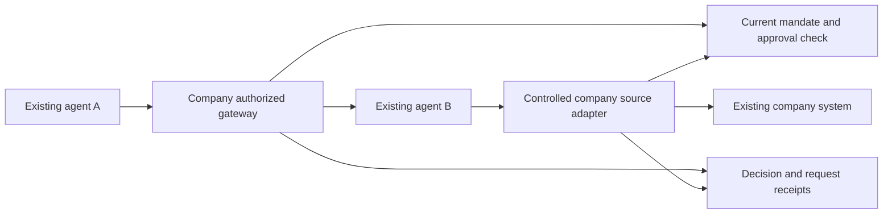

<!-- studio {"id":"mesh:research:agent-workplace","scope":"mesh","type":"research","status":"proposed","links":[{"relation":"requires","target":"mesh:decision:product"}]} -->
# Agent workplace feasibility viability and desirability

Mesh-owned research reference from 10 November 2026. Ported from the earlier World-scoped report; historical run links remain historical. The original market conclusions are proposed validation hypotheses. Codex/OpenClaw communication succeeded with permissions/revocation; a subsequent native OpenClaw funded Operations proof also completed with USD0.000236 reported by OpenRouter and matching key usage. These proofs establish tested technical routes, not customer demand, production security or a settled enterprise invoice. Current scope and closed spending authority are in [Mesh decisions](PRODUCT_DECISIONS.md) and [the funded run](runs/2026-11-10-funded-openclaw.md). The World application, stack and older roadmap do not govern Mesh.

8 November 2026 · Founder decision report · Recommendations for validation

10 November direction update: the founder includes company-funded approved model usage in the initial BYOA goal. Use existing gateways and supported runtime integrations; personal usage stays self-funded. This supersedes the original funding exclusion below. Reimbursement is a fallback. The subsequent installed native OpenClaw SDK proof through hosted OpenRouter completed under an explicit USD1 cap, using GPT-4.1 mini: reported costUSD0.000236 matched key usage and work access is now closed. See [approved decisions](PRODUCT_DECISIONS.md) and [funded Mesh run](runs/2026-11-10-funded-openclaw.md). This adds actual funded-request evidence beyond communication or key authentication; enterprise billing/security and customer demand remain unvalidated.

**Pursue a bounded validation of company-authorized collaboration between existing agents. Start with one company, two already useful agents in different runtimes, and one recurring handoff. Keep execution, model choice and company knowledge in their existing systems.**

The technology is sufficiently established to justify an integration proof. The business case is plausible but not established. Desirability depends on completing useful work with less permission chasing and integration effort; an agent registry alone is unlikely to demonstrate that value. Similarity to AgentMesh and other competitors is acceptable. We need a reason for a particular customer to choose us, without inventing a new category or expanding into a runtime or KMS.

| Lens | Assessment | What must become true before further investment |
| --- | --- | --- |
| Technical feasibility | Tested framework and native Codex combinations work; broader compatibility remains unverified | A named version/authentication combination works, and unauthorized disclosure is blocked at a real enforcement point |
| Business viability | Worth testing; no validated revenue or demand for this offering | An accessible buyer has a recurring handoff, can authorize both endpoints, and will pay enough to cover integration and support |
| User and technology desirability | Strong conditional rationale for managed mixed-runtime teams; personal BYOA remains less certain | Users retain their working tools, understand permissions, and prefer the complete experience to their current workaround |

The original 8 November assessment combined public sources with independent technical, business and design research and discussion. At that point no customers were interviewed, competitor products operated, integration proof executed or production security assessed. The following update records subsequent execution evidence. Product documentation establishes documented capabilities, not independently verified performance or adoption. Numerical commercial scenarios and validation thresholds below remain proposed decision tools.

### Technical evidence added 9 November 2026

Subsequent isolated execution demonstrated Mastra1.80.0 to Google ADK2.14.0 over A2A0.3.0 using deterministic model fixtures: twelve integration scenarios and seven authority test groups passed, including source-boundary revocation/expiry and no automatic resend after interruption. This establishes the tested SDK/transport/control combination, not live model quality or production security.

The user's OpenClaw2026.9.3 on Hetzner passed SSH and OAuth-only, zero-tool preparation checks. Installed-source diagnosis reproduced an empty usable-auth order: native exec's cross-state store excludes shared OAuth credentials. The supported public SDK owner-bound isolated-completion route then passed a zero-inference probe through its final pre-provider assertion. Five attempted native turns still produced no verified model/echo success. The final attempt returned a native error assistant; its sanitized durable receipt and separate read-back matched, proving the corrected connector evidence path works. Earlier outcomes and unknown usage remain preserved, and all live gates are closed. Existing gateway configuration/service, installed source and workspaces are preserved; no credential transplant or API-key fallback is used. These observations support runtime-specific tested contracts rather than universal compatibility claims. See [OpenClaw proof run](../world/runs/2026-11-09-openclaw-proof.md) and [two-framework proof](../world/runs/2026-11-09-workplace-proof.md). The analysis below retains its 8 November source date; execution evidence does not establish customer demand.

At the user's direction, a separate Codex-first proof then verified a local handoff from a maintained Mastra1.80.0 test sender to native Codex CLI0.167.0-alpha.3.2 using its existing ChatGPT login. Codex completed a fresh fictional JSON request with an exact reply, zero observed effect-tool items and one nonfatal native warning;26offline checks and independent review passed. The earlier Codex attempt remains unverified. Approval/field/model/recipient/tenant checks, expiry/revocation at final dispatch and no-resend/replay controls were exercised in fixtures. Codex retains execution/planning/authentication; the connector adds authority and receipts. This is evidence for one tested native connector, not universal interoperability, production security, customer demand or OpenClaw success. See [Codex proof run](../world/runs/2026-11-09-codex-proof.md).

## 1 The product responsibility

Working promise: **Connect existing agents to approved company work, with a responsible owner, bounded authority and understandable records.**

The product establishes who may participate and mediates specified interactions. It does not decide how an agent reasons, plans, selects tools or produces its answer. Running an ordinary authorization server is necessary infrastructure; operating an agent execution engine is outside the approved boundary.

| We would own within a bounded scope | Existing systems retain |
| --- | --- |
| Agent registration and association with an authenticated owner and company | Agent creation, prompts, planning and execution |
| Named capabilities, approved counterparties and workplace mandates | Models, inference routing, memory and runtime recovery |
| Permission decisions, human approval, expiry and revocation | Knowledge storage, authoring, search and document editing |
| Mediation of supported A2A requests and governed resource/tool access | Business source records and their underlying access rules |
| Records of what crossed our boundary and what was reported back | Responsibility for agent output quality and independently controlled business effects |

Do not add a chat suite, workflow canvas, agent marketplace, knowledge editor, model router, proprietary billing engine or portable reputation score to make the first product look complete. Company-funded approved inference should reuse an existing gateway and supported runtime route. Necessary identity, policy, approval and audit storage is part of the service, not a KMS. A request/status ledger is part of communication accountability, not authority to build autonomous scheduling.

Agent Passport can begin as a stable identifier with owner, issuer, current company mandate and credential status. Portable professional history is a later issuer-and-trust problem. A signature does not establish competence or the truth of a work claim; changing the model, tools or instructions can also change performance. W3C Verifiable Credentials provides a possible representation for signed claims, not a complete authorization or reputation system. [W3C VC Data Model 2.0](https://www.w3.org/TR/vc-data-model-2.0/)

## 2 Evidence for the opportunity

### An established problem category

Deloitte's 12 October 2026 discussion of personal agents at work identifies company access, governance, ownership and who pays as unresolved issues. It also says organizations may not yet face personal-agent onboarding at scale. This supports investigating the problem while warning against assuming a ready mass market. Broad AI use and unsanctioned AI use are not measures of demand for interoperable autonomous agents. [Deloitte personal agents at work](https://www.deloitte.com/global/en/insights/topics/emerging-technologies/personal-ai-agents-at-work.html)

More concrete commercial signals exist in named vendor customer accounts. Agen publishes statements about employee AI enablement and governed external MCP access; Gravitee publishes customer statements about governed tools and centralized access. These are useful evidence of real jobs, but remain vendor-published rather than independently measured outcomes. They do not prove that our proposed first segment has the same needs or budget. [Agen customers](https://agen.co/customers), [Gravitee agent management](https://www.gravitee.io/platform/ai-agent-management)

The strongest unresolved question is not whether agent governance matters. It is whether we can reach companies with a specific, repeated collaboration problem that their current tools solve poorly enough to justify another supplier.

### Singapore relevance without a regulatory business assumption

On 4 November 2026, Tin Pei Ling proposed national digital identity infrastructure for agents. CNA's parliamentary coverage records the government's agreement with the objective and its intention to build on existing infrastructure and emerging standards before assessing whether additional infrastructure, including a national registry, is needed. This is relevant policy context, not an announced requirement to buy a private agent passport or an appointment of a universal issuer. [CNA parliamentary coverage](https://www.channelnewsasia.com/watch/adjournment-motion-national-digital-identity-infrastructure-ai-agents-6524406)

Separately, MDDI's 4 November response on agentic AI assurance says the industry's shape remains uncertain and emphasizes developing practical testing methods with adopters. This favors evidence from a narrow deployment over a claim to national infrastructure status. Singapore may be an accessible place to recruit research participants; it is not yet an approved exclusive market or a regulatory sales channel. [MDDI assurance response](https://www.mddi.gov.sg/newsroom/mddi-s-response-to-pq-on-establishing-singapore-as-global-leader-in-agentic-ai-security-and-assurance/)

Zetrix and CAICT's 5 November KYA announcement also covers verifiable agent identity and delegated authority. Its cross-border pilot is described as planned, with participation subject to confirmation. This is another adjacent competitor and ecosystem signal, not proof of a settled global standard or demonstrated market adoption. [Zetrix announcement](https://www.zetrix.com/zetrix-ai-and-china-academy-of-information-and-communications-technology-unveil-know-your-agent-kya-service-to-bring-trust-and-accountability-to-ai-agents/)

### Competition and the reason to choose us

| Alternative | Relevant documented overlap | Implication for our approach |
| --- | --- | --- |
| AgentMesh | Names, keys, owners, IdP connections, A2A/MCP, mandates, approvals and records. Its broader Combine offering includes processes and agent creation. | Direct comparison is essential. We can compete on a narrow journey without reproducing its broader platform. [Suite](https://agentmesh.ai/) |
| Microsoft Agent 365 and Entra | Agent identity and governance within Microsoft's administrative ecosystem; standalone licensing is per user, not per agent. | A basic registry may duplicate existing entitlement. The licensing FAQ lists US$15/user/month standalone, with qualifying base licenses and usage-specific obligations; this is not a complete adoption cost. [Licensing FAQ](https://www.microsoft.com/licensing/faqs/122) |
| Solo agentgateway | Maintained gateway infrastructure with agent/tool connectivity and authorization capabilities. | Both a substitute for technical teams and a component to evaluate. A thin user interface over unchanged gateway configuration needs a stronger value case. [Product](https://www.solo.io/products/agentgateway) |
| Agen by Frontegg | Owner mapping, action governance, approval and evidence; explicitly priced per governed agent with numerical rates by quotation. | Exact-action approvals are already commercial features. Our differentiation must be in the chosen customer's adoption and job outcome. [Pricing](https://agen.co/pricing) |
| Gravitee | Agent catalog, gateway and governance across its existing API estate. | Existing gateway customers may rationally extend their current vendor. Published API package prices are not verified prices for the relevant agent configuration. [Agent management](https://www.gravitee.io/platform/ai-agent-management), [pricing](https://www.gravitee.io/pricing) |
| Current process | Direct APIs, existing automation, human copying and chat/email escalation, company IdP plus gateway | Compare the full job, including setup, permissions, handoff and recovery. A new protocol is not automatically an improvement. |

AgentMesh's current buying page describes a scoped departmental pilot followed by subscription, in vendor or customer cloud, with engineering support and security review material. It publishes no numerical price there. This suggests a concrete comparison: can a qualified team complete our supported onboarding with less effort, clearer authority and a useful recurring outcome? Its sales-led model does not itself prove that a self-service gap exists. [AgentMesh buying process](https://agentmesh.ai/how-to-buy.html)

A defensible early advantage could be a small set of reliably tested adapters, repeatable mandate templates for a real job, clear failure evidence and consistently low onboarding effort. None is established today. Price, vendor neutrality and usability can matter without constituting a unique invention.

### AgentMesh source review, 9 November 2026

The original comparison means AgentMesh at agentmesh.ai. Its [self-hosting guide](https://dev.agentmesh.ai/running-a-mesh.html) points to [agent-messaging/agent-messaging-server](https://github.com/agent-messaging/agent-messaging-server), whose README identifies AgentMesh as its sponsor. This is separate from Google's similarly named Agent Mesh and Microsoft's governance toolkit. Reviewed source is pinned to commit `310625ae92b95e2b8369903f2e28b19d98d1ab1b`. The server and TypeScript SDK are Apache-2.0; current inspected releases are server0.5.3 and SDK0.68.0. We read source and tests without installing or running their stack. [README](https://github.com/agent-messaging/agent-messaging-server/blob/310625ae92b95e2b8369903f2e28b19d98d1ab1b/README.md), [server release](https://github.com/agent-messaging/agent-messaging-server/releases/tag/server-v0.5.3), [SDK release](https://github.com/agent-messaging/agent-messaging-server/releases/tag/sdk-v0.68.0).

There is substantive implementation behind the overlap: signed envelopes, identities, durable mailboxes, admission, delegation and approval verification. The stack uses NATS JetStream or RabbitMQ with Postgres. Adoption would introduce operational infrastructure; it should be evaluated as a potential future messaging component rather than as the immediate fix for Codex making no tool call. Their own MCP integration still needs the native assistant to invoke a tool. [Repository](https://github.com/agent-messaging/agent-messaging-server/blob/310625ae92b95e2b8369903f2e28b19d98d1ab1b/README.md), [MCP integration](https://dev.agentmesh.ai/mcp.html).

Permission and revocation mechanisms have distinct boundaries. Signed delegation and exact-act approval verification exist, but delegated-envelope checking must be called by the receiver; its revocation callback is optional. A business application must still decide whether the authenticated delegation permits an inventory read. [Delegation verifier](https://github.com/agent-messaging/agent-messaging-server/blob/310625ae92b95e2b8369903f2e28b19d98d1ab1b/sdk-typescript/src/delegation.ts).

Receiver-side revocation caches a good answer for60seconds and failed lookups for15seconds, with a2second lookup timeout; an unknown lookup allows processing, while a previously known permanent revocation stays blocked. Broker connection cutting is a separate mechanism: the source reports live, fallback or none, and its fallback may leave credentials usable until renewal, within7days. Thus transport revocation is not a substitute for our fail-closed current-grant check immediately before the fictional business-source callback. These are code observations, not results from our deployment or a claim every AgentMesh configuration has the same delay. [Receiver cache](https://github.com/agent-messaging/agent-messaging-server/blob/310625ae92b95e2b8369903f2e28b19d98d1ab1b/sdk-typescript/src/internal/revoked-senders.ts), [connection-cut result](https://github.com/agent-messaging/agent-messaging-server/blob/310625ae92b95e2b8369903f2e28b19d98d1ab1b/server/src/keychain/kill-switch-cut.ts).

Recommendation: borrow the explicit admission, signed exact-action approval and honest revocation-status ideas; evaluate a pinned library only when a proven cross-environment messaging need warrants its infrastructure. Do not adopt or recreate a complete mesh, runtime or KMS for this proof. Generic identity, agent messaging and a kill switch already have direct competition. The proposed customer reason to choose us remains reliable completion of existing company work with current source authority, company templates, human review and clear outcome evidence. Similarity is evidence of category activity; willingness to pay and our differentiation still need customer validation.

## 3 The first customer and job

### Recommended customer hypothesis

Recruit a technically capable software or service company with two already useful agents in different environments, one repeated cross-team handoff, a named integration owner and authority to approve both endpoints. A rough screening range of 50–500 staff may help prospecting, but the operational conditions matter more than headcount. We should not infer SME budgets from enterprise governance surveys.

The platform or engineering lead is the likely technical champion and budget owner. Security/IT approves access and deployment. A department leader owns the business outcome. In a smaller company, a CTO may perform several of these roles. An employee who likes the idea is not sufficient buying authority.

| Entry route | Why it could work | Why not start broadly here |
| --- | --- | --- |
| Company-managed agents in different runtimes | One organization can approve both ends, constrain access and assign responsibility | Still requires evidence of a valuable recurring handoff; recommended first test |
| Personally operated employee agents | Preserves employee investment and preferred tools | Company/personal data mixing, local-device availability, provider restrictions and uncertain company willingness to fund it |
| Agents collaborating across businesses | Potential value tied to service delivery and customer relationships | Two-sided onboarding, federation, contracts and incident ownership increase the initial burden |

Starting with managed endpoints narrows the first experiment, not the long-term vision of agents bringing their identity to different workplaces. Personal and cross-company participation can be added when an anchor customer demonstrates the need and can authorize the relevant controls.

### Proposed first workflow

A support agent needs an account-specific service-entitlement assessment from an existing operations agent before the support employee responds to a customer. The operations agent may interpret a bounded request or ask for clarification. If the job is merely a fixed record lookup, test whether a direct API already solves it adequately.

1. The company identifies the existing agents, responsible owners, source system and allowed task.
2. The receiving owner permits a named skill for specified callers, account scope, fields and expiry.
3. The employee starts work through their existing agent interface.
4. Our service authenticates the request and checks the current mandate. A controlled source adapter enforces record-level access and minimum disclosure.
5. Any required human approval occurs before the protected disclosure. The approved request is handed to the existing receiving runtime through A2A.
6. That runtime performs its own work and returns an answer, clarification or failure. We label the answer as reported by that agent.
7. The originating agent/human continues its existing workflow. Sending a customer response, changing a contract or issuing a refund is outside this initial slice.

Use fictional accounts and read-only access for the first technical proof. Test an actual request/status/result exchange and a separately governed resource call. The first demonstrates agent collaboration; the second demonstrates resource access control. Neither alone establishes the complete customer benefit.

## 4 Desirability and the working experience

The employer wants useful work with accountable ownership. The employee wants less copying and waiting while retaining familiar tools. The receiving operator wants control over callers, data exposure and unexpected workload. The integrator wants a small, documented compatibility contract and failures that can be diagnosed.

Registration should follow a chosen job. A directory full of agent profiles is not the first useful result. The minimum administrative experience is connect a tested endpoint, assign its responsible owner, grant a bounded mandate, handle exceptional approval, inspect activity and revoke access. Ordinary users should remain in their existing agent interfaces where supported.

Atlassian's Rovo A2A documentation illustrates why protocol support is insufficient: it requires OAuth, PKCE, dynamic client registration and user consent, while organization enablement is a separate prerequisite. A discoverable Agent Card does not demonstrate working access. [Rovo authentication](https://developer.atlassian.com/cloud/rovo-a2a/authentication/)

### Explain four separate facts

Avoid one broad “verified agent” badge. Show whether its identity credential is authenticated, its company mandate is active, its capability has passed our stated compatibility test, and its endpoint is currently reachable. None implies that its answers are correct.

An approval should identify the requesting agent and owner, receiving operator, purpose, exact proposed data/action, affected account, expiry and consequence. Show a concise explanation with inspectable details. A changed recipient or payload must require renewed authorization. Routine low-risk work should fit standing mandates; requiring a human click for every message undermines the benefit.

A developer discussion in MCP recorded a specific consent problem involving visibility of the ultimate client. It supports clear delegation displays, but is a historical issue report rather than evidence that every current integration has the problem. [MCP consent discussion](https://github.com/modelcontextprotocol/modelcontextprotocol/discussions/265)

### Use states we can support

| Observable state | What the user should understand |
| --- | --- |
| Awaiting approval | No protected dispatch/disclosure has occurred; a named approver is responsible |
| Denied or expired | The request cannot proceed under that authority; show the reason and permitted next action |
| Endpoint unavailable before dispatch | Nothing was knowingly delivered; the caller can decide when to try again |
| Dispatched or acknowledged | The request crossed our boundary; business completion has not been established |
| Remote-reported working or completed | The receiving runtime reported this state; show its receipt and source |
| Delivery or outcome unknown | Dispatch may have occurred; do not invite a blind resend |
| Revoked for new requests | Future admissions are blocked; earlier disclosures/effects remain possible |
| Cancellation requested | Work is not confirmed stopped until the receiving runtime acknowledges it |

Do not add an offline mailbox or background redelivery to the first version. A documented unavailable/unknown state is adequate until a real customer needs durable delivery and its semantics are separately scoped. This resolves an early design suggestion for offline queues without drifting into execution scheduling.

Company monitoring should cover only disclosed, mediated work. Do not imply access to an employee's unrelated conversations, memory, files or browsing. Avoid public rankings or publishing task history. Invite/acceptance to connect is distinct from permission to access information.

## 5 Technical approach

### Use standards without outsourcing the policy decision

A2A provides messages, tasks, artifacts and lifecycle operations; authorization scope remains implementation-specific. Cancellation is best effort, and sending is not universally idempotent. The protocol can carry a collaboration but does not grant company authority, guarantee completion or supply rollback. [A2A specification](https://a2a-protocol.org/latest/specification/)

MCP's HTTP authorization specification defines transport-level authorization and audience/resource validation. A token issued for one service must not simply be forwarded to every downstream server. STDIO integrations require a different credential path. The company mandate and exact-action approval contract still belong to the application and resource server. [MCP authorization](https://modelcontextprotocol.io/specification/2026-07-28/basic/authorization)

OAuth token exchange can represent a subject and an acting party. Its actor history is not an automatic transitive permission chain; every delegation must be constrained by the issuer and receiver. Keep the originating human, calling agent, company and effective mandate identifiable even when a gateway makes the downstream connection. [RFC 8693](https://www.rfc-editor.org/rfc/rfc8693)

### Proposed component choices

These are candidates for a compatibility proof, not selected production dependencies.

| Component | Recommendation to evaluate | Boundary and tradeoff |
| --- | --- | --- |
| Protocol mediation | Maintained agentgateway standalone/container | Reuse proxy infrastructure; enable only needed agent/tool paths, not its model-routing features |
| Human/workload identity | Customer identity provider and established OAuth/OIDC libraries | Existing browser sessions are not external agent identity; avoid inventing a universal identity authority |
| Workplace application | Small service in the team's familiar TypeScript stack | Own registration, mandate/approval lifecycle and records; no Mastra execution loop inside this service |
| Policy evaluation | Explicit application authorizer plus simple gateway rules | Add a separate OPA service only if actual policy complexity justifies another dependency |
| Record-level access | Source-system permission enforcement or narrow controlled adapter | Generic gateway rules cannot establish every business record entitlement |
| Durable state | PostgreSQL for versioned mandates, approvals, revocations and request receipts | Tenant isolation and transactional transitions matter; this does not justify storing company knowledge |
| Keys and secrets | Existing identity-provider and managed secret facilities | Use narrow credentials and issuer/key references; do not build a key-management product |
| Operations | Bounded metadata, traces, retention and export | Avoid raw prompts, reasoning and a content archive; account for support and incident handling |

Agentgateway's repository is Apache-2.0 licensed and has maintained releases. The inspected release was v1.7.0 dated 27 October 2026. Those facts make it worth evaluating; they do not establish fitness or eliminate license, dependency and operational obligations. Start with a small deployment rather than adopting Kubernetes as a prerequisite. [Repository](https://github.com/agentgateway/agentgateway), [releases](https://github.com/agentgateway/agentgateway/releases)

An important documented caveat is that `mcpAuthorization` can inspect tool name/target but not arguments; route-level authorization can access arguments. We must prove that the chosen enforcement hook sees and checks the exact account, recipient and payload before dispatch. A generic “authorization enabled” setting is insufficient. [Agentgateway MCP authorization](https://agentgateway.dev/docs/standalone/latest/documentation/configuration/security/mcp-authz/)

OPA, if used, must return an explicit permit: a successful HTTP response can still represent an undefined decision with no result. PostgreSQL row security is complementary to application checks, and owners or privileged bypass roles do not behave like ordinary application users. Fail closed on missing policy results; use appropriately restricted database credentials. [OPA REST API](https://www.openpolicyagent.org/docs/rest-api), [PostgreSQL row security](https://www.postgresql.org/docs/current/ddl-rowsecurity.html)

### A concrete compatibility probe

Mastra's current A2A documentation states version 0.3.0. Google ADK's consuming documentation supports Python SDK 0.3.x and 1.x.x, with experimental support caveats. The current A2A specification is newer than Mastra's documented implementation. Evaluate **Mastra and ADK at an explicitly verified common version**; do not assume compatibility because both name A2A. [Mastra A2A](https://mastra.ai/docs/connections/a2a), [ADK consumption](https://adk.dev/a2a/quickstart-consuming/)

Record exact SDK, protocol, gateway and authentication versions in the proof. Test discovery, authenticated message submission, clarification, status, result artifact, timeout and cancellation. Existing maintained sample endpoints with fictional/deterministic behavior can test transport without paid inference; that result would not prove model quality or customer utility. A later useful-work pilot needs independently functioning customer agents.

Public documentation for current Mastra does not prove that the installed World application exposes those endpoints. The existing World implementation contains useful session/membership, versioned-policy and transactional approval patterns. Its assistant/model/Knowledge-specific authorization is not a ready external workload identity system. Reuse proven patterns selectively; isolate the proof from the existing document/runtime flows and preserve their data and services.

### Request and trust flow

The sequence depends on who holds the source data. If A supplies protected data, approval and minimization occur before A-to-B disclosure. If B retrieves it, B's controlled source adapter checks authority before release. A gateway check at the beginning cannot replace the later source check. Both endpoints retain their own authorization responsibilities.

The minimum decision input includes tenant, human subject where applicable, calling agent, recipient, operation/skill, resource scope, exact payload binding, mandate and policy versions, expiry and delegation context. The result is permit, deny or approval-required with a reason and correlation identifier. Store an exact-request approval, not a reusable blanket “yes.”

## 6 What can actually be enforced

The first deployment should cover company-managed endpoints and protected resources whose access path can be constrained. Registration does not control a process. If an agent retains unrestricted direct credentials, our service cannot claim comprehensive enforcement.

| Risk | Required design or test | Limit that remains |
| --- | --- | --- |
| Impersonation or confused delegation | Authenticate issuers and audience; retain subject/actor attribution and approved endpoint ownership | A credential holder may still operate a compromised or unreliable agent |
| Cross-company/account access | Authoritative tenant membership and record-level checks at the source boundary | A request's asserted account or purpose is not proof of entitlement |
| Approval substitution/replay | Bind tenant, actors, recipient, operation, payload digest, resource versions, expiry and policy; consume atomically | A digest proves equality, not correctness or safety |
| Stale authority | Online checks before protected disclosure/effect, on resume and on new status access; defined cache behavior | Offline signed credentials cannot provide instantaneous global revocation |
| Ambiguous delivery | Retain correlation/task IDs, expose uncertainty, reconcile status under current authority | An unacknowledged dispatch may have run; automatic resend can duplicate work |
| Broad free-text content | Constrain the supported request/response contract and source fields; receiving owner approves runtime/data handling | A schema cannot prove arbitrary prose contains no confidential information |
| Endpoint abuse | Approved destinations, controlled egress, size/rate limits and explicit discovery/redirect handling | Do not accept arbitrary registered URLs as trusted company destinations |
| Agent exhaustion or abuse | Per-caller admission/concurrency limits agreed with receiving operator | We cannot meter or cap all external runtime inference without another integration |
| Evidence manipulation | Restricted writers, stable correlation, protected retention/export and clear receipt provenance | Application append-only records alone are not tamper-proof evidence of all behavior |

An agent B with broad private memory or other tools could put unrelated information in its response even if one source adapter was properly scoped. The receiving organization must approve and constrain that runtime's data handling. Content inspection and narrow schemas can reduce exposure; they do not establish a universal semantic no-leak guarantee.

Separate request authorized, request dispatched, receiver acknowledged, remote-reported completed and effect independently confirmed. Do not equate the agent's statement of success with proof of a business effect. A revoked mandate blocks future authorized use; it does not erase received information or undo a completed action. These distinctions are essential to the product's credibility.

For sensitive actions, short-lived credentials supplement rather than replace current policy checks. No blind resend follows an ambiguous `SendMessage` timeout. If a remote task ID exists, a caller-driven status request may reconcile it under current policy. Durable offline redelivery, generalized recovery and scheduled retries remain outside the first scope.

Default to necessary metadata and bounded retention. Exact approval can use canonicalized payloads and digests without retaining full documents; low-entropy sensitive values may need keyed digests. Metadata itself can be confidential. A TLS-terminating cloud relay can see content in transit even if it does not retain it. Full platform opacity and centralized semantic content inspection cannot both be promised; customer-side enforcement is a deployment option with extra installation/support cost.

For production, the proof must be followed by threat-model-driven independent security review, tenant and credential isolation checks, recovery/retention verification and agreed incident responsibility. None of this report confers certification, compliance or production-readiness status.

## 7 Business model and operating economics

### Sell a bounded work capability

Test a company/workspace subscription with defined included agents, integrations, request volume and metadata retention. Include ordinary approvers rather than charging for each approval. Price bespoke integration and customer-hosted operation separately. Avoid a fee per “successful outcome” before correctness and attribution are well defined.

A per-agent component may be understandable, but key rotation and redeployment must not arbitrarily inflate counts. An active governed registration tied to a responsible owner and endpoint is a starting definition to test. A workspace base absorbs fixed tenancy/support costs. Do not charge for an unlimited-control promise that cannot be enforced.

Original 8 November funding recommendation, superseded on 10 November: employer inference sponsorship was excluded initially. The approved direction now includes sponsor-funded model usage through an existing gateway, separately from personal usage. A gateway request record does not transfer an employee's subscription or bill: the supported work route must actually use the designated sponsor credential, and reported cost must be reconciled separately from estimates and uncertain outcomes.

### Illustrative economics rather than a forecast

Use **US$500/month** as one pricing-research anchor for a bounded company pilot-to-subscription, not a chosen public price. Assume ten governed agents and 100,000 mediated metadata events monthly. At an assumed 2 KB per event, raw storage is 0.2 GB per month; 90 days with a hypothetical 3× indexing/replication allowance is about 1.8 GB. Payloads and documents are excluded.

| Recurring monthly item | Hypothetical planning range |
| --- | --- |
| Allocated application/database hosting | US$40–90 |
| Logs, backups, network and exports | US$10–30 |
| Support, 1–2 hours at an assumed US$50/hour loaded rate | US$50–100 |
| Direct recurring cost | **US$100–220** |
| Contribution at US$500 revenue | **US$280–400, or 56–80%** |

These inputs are assumptions to challenge, not provider quotations, an authorized spend or measured unit costs. Contribution excludes engineering, selling, independent assurance, insurance, taxes and founder compensation beyond the assumed support allocation. Long retention, payload inspection, private deployments or enterprise availability commitments can invalidate the scenario.

Integration effort is the early economic hazard. Eight onboarding hours at the same hypothetical rate cost US$400. A separately tested US$1,000 setup fee could cover a bounded integration; a customer may refuse it. At the midpoint US$85 infrastructure/log allocation, five monthly support hours cost US$250, leaving only US$165 contribution on US$500 revenue before the excluded costs. Lower pricing is sustainable only with correspondingly lower support or another demonstrated cost advantage.

For a customer valuing staff time at an assumed US$50/hour, US$500/month requires ten hours of time value just to equal the subscription, before amortizing onboarding. Measure that value after approval effort and rework. Do not invent avoided incident costs to make a weak time-saving case look attractive.

### Access to customers

Begin with founder introductions, technical companies already operating agents, runtime communities and implementation consultancies. Ask to examine one recent handoff, not to hear opinions about a broad future workplace. A reproducible compatibility proof can attract the right integrators; impressions and agent-registration counts are poor commercial metrics.

MSPs or security consultancies could become a channel after onboarding repeats reliably. Initially they are also a useful comparison: can an existing gateway/IdP configuration solve the job as cheaply? No outreach, partnership or public release has been performed or authorized in this research run.

## 8 A phased way to tackle it

Use evidence gates rather than promising a delivery date before finding the customer and testing the adapters. The phases below are recommended next scopes, not automatic implementation or spending authority.

| Phase | Work and output | Proposed continue condition |
| --- | --- | --- |
| 1 Problem discovery | Research eight qualified companies with existing agents; interview buyer, originating owner and receiving operator around recent handoffs | Four companies show an actual recurring job and baseline; three name an integration owner and plausible budget path |
| 2 Isolated compatibility proof | Fictional data, two named runtimes, one A2A handoff, one protected resource adapter, no model quality claim | Tested pinned protocol/auth combination, explicit enforcement evidence and honest failure states |
| 3 Role-separated prototype | Connect, mandate, approval, receipt and revocation journey with buyer/owner/integrator roles | Five of six users understand recipient and revocation limits; every tested approver spots a changed recipient/payload, otherwise redesign |
| 4 Bounded company pilots | Existing useful agents; read-only workflow, agreed data/deployment scope, baseline and operating owner | Two teams repeat weekly for four weeks, with at least 30% lower human handling time and no increase in rework or consequential disclosure errors |
| 5 Commercial repeatability | Price actual scope and include setup/support economics; assess incumbent alternative | Two unrelated teams accept priced paid pilots or procurement-backed equivalent commitments, at a price consistent with observed costs |

Small samples and zero observed errors do not establish population demand or security assurance. The thresholds are founder decision rules to avoid indefinite feature building. Record comparable work volume, outliers and approval/rework effort rather than reporting one impressive demo.

### The integration proof must be falsifiable

Require valid authorized handoff; wrong tenant/account/counterpart denial; expired mandate; policy change while approval waits; changed-payload approval rejection; revocation before dispatch/source release; permitted and denied status access; disconnected receiver; ambiguous timeout without automatic resend; and duplicate request behavior. Trace both the gateway and receiving boundary so we can establish whether a denied request arrived.

For a read-only proof, verify the absence of unauthorized disclosure. A later write-capable slice additionally needs exact-effect approval, idempotent application effects and effect-time authorization; it cannot inherit a read-only PASS. Measure revocation according to explicit freshness and timing semantics rather than promising an instant global kill switch.

After adapters exist, target repeat customer onboarding within one engineer-day, with a configured end-user reaching the synthetic first handoff within 60 minutes. These measure different work: technical installation versus use of a preprovisioned supported setup. Target no more than two support hours per customer/month initially and verify against actual support records.

Stop or narrow if customers have no repeated cross-agent job, cannot control bypass paths, reject the data handling, prefer their current API/automation process, or require us to build the agents/KMS to realize the benefit. A failed workflow hypothesis does not require abandoning the entire category; it does require changing the job or segment before adding infrastructure.

## 9 How the agent discussion changed the recommendation

| Challenge | Resulting recommendation |
| --- | --- |
| Business questioned whether personal BYOA has a company payer and manageable onboarding | Start with company-managed mixed-runtime endpoints; preserve personal portability as a later hypothesis |
| Design questioned whether a lookup was being presented as agent collaboration | Choose a handoff where an existing receiving agent adds useful assessment/clarification; compare directly with API plus human escalation |
| Technical challenged “verified agent” and instant revocation claims | Separate credential, mandate, compatibility and reachability; distinguish blocking new requests from stopping remote work |
| Design asked for clear offline behavior; technical identified redelivery/retry hazards | Keep first scope to unavailable/unknown states and caller-driven reconciliation; defer an offline mailbox |
| Root and technical examined payload-aware approval | Add an explicit source adapter/authorizer; do not assume generic gateway authorization or a schema establishes safe disclosure |
| All three examined the direct competitor | Keep the narrow boundary and test onboarding/job value; similarity does not disqualify the opportunity |

The preferred next commitment is **customer problem discovery plus an isolated interoperability/enforcement proof**. It is premature to fund a broad workplace platform, but the evidence is sufficient to investigate a focused product. Keep the approved no-runtime/no-KMS boundary as a feature filter throughout.

Open founder choices are the first reachable customer cohort, the single handoff, acceptable deployment/data path, and the next bounded research/proof budget. Technology choices should follow the pinned proof; pricing should follow buyer and support evidence. Portable professional credentials, personal-device connectors and cross-company federation remain sequenced possibilities. Company-funded supported usage is now part of the initial goal; the funded OpenRouter proof still needs its designated sponsor credential, model and cumulative cap.
